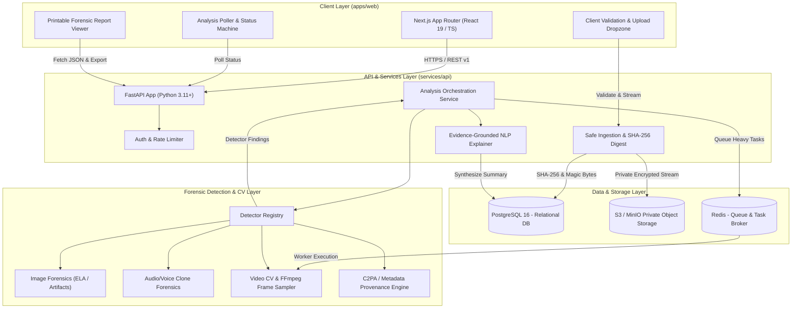
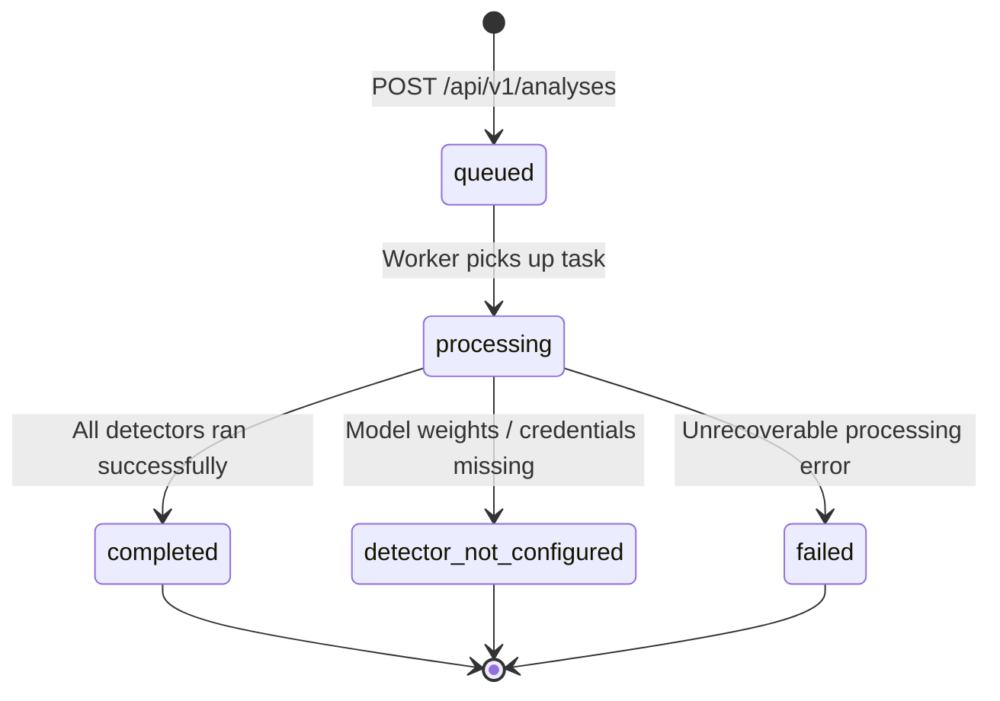

# OmniScan — System Architecture & Design Specification

## 1. System Overview

**OmniScan** is an enterprise-grade AI Deepfake, Voice Clone & Synthetic Media Detection Platform. It is engineered to help security analysts, journalists, forensic investigators, and developers scrutinize images, audio, and video for signs of synthetic generation or algorithmic tampering.

The architecture emphasizes modularity, cryptographic integrity, defense-in-depth security, and strict separation between probabilistic model inference and deterministic evidence reporting.

---

## 2. High-Level Architecture Diagram

---

## 3. Component Details & Boundaries

### 3.1 Client Layer (`apps/web`)
- **Technology**: Next.js 15 App Router, React 19, TypeScript with strict mode, Tailwind CSS, Lucide icons.
- **Responsibilities**:
  - Drag-and-drop file upload with client-side magic byte and size pre-checks.
  - Interactive forensic dashboard showing detector statuses, findings, and limitation disclaimers.
  - Real-time polling of analysis progress with deterministic state machine transitions.
  - Printable forensic reports (`/reports/[analysisId]`) with evidence citation.
  - Zero secret exposure: No private keys or cloud secrets in client bundles.

### 3.2 Backend API (`services/api`)
- **Technology**: Python 3.11+, FastAPI, Pydantic v2, SQLAlchemy 2, Alembic.
- **Responsibilities**:
  - File ingestion: Header & signature validation, path sanitization, SHA-256 fingerprinting.
  - Private object storage management: Pre-signed URL generation and zero direct public access.
  - Analysis orchestration: Dispatching tasks to synchronous pipelines or background queues.
  - Safe error handling: Structured RFC 7807 error envelopes without internal trace exposure.

### 3.3 Forensic Inference Adapters (`services/api/app/detectors`)
- **Technology**: Modular Python adapters implementing `BaseDetector`.
- **Key Modules**:
  - `ImageDetector`: Frequency spectrum (FFT/DCT), Error Level Analysis (ELA), and deep learning feature checks.
  - `AudioDetector`: Spectral analysis, vocoder artifact identification, synthetic pause distribution.
  - `VideoDetector`: FFmpeg frame extraction with bounded time/resolution limits, facial jitter and temporal continuity checks.
  - `ProvenanceChecker`: C2PA metadata extraction and EXIF/XMP consistency checks.
- **Core Principle**: If a model or weight file is unconfigured, return `detector_not_configured` immediately. Never fabricate scores.

### 3.4 Data & Storage Architecture
- **PostgreSQL**: Stores relational metadata (users, uploads, analysis runs, detector results, provenance records). No binary media bytes in database rows.
- **S3 / MinIO**: Private bucket storing encrypted media objects keyed by UUID. Expiring presigned URLs used for authorized preview/processing.
- **Redis & Task Worker**: Coordinates bounded, asynchronous video frame sampling and deep learning inference tasks.

---

## 4. Analysis State Machine

Invalid transitions are rejected with HTTP 409 Conflict.

---

## 5. Security Architecture & Threat Model

1. **Upload Protections**:
   - File size caps (Images: 25MB, Audio: 50MB, Video: 150MB).
   - Real signature validation (magic bytes via `filetype` / `python-magic`) matching declared MIME types.
   - Strict filename normalization to prevent path traversal (`../../`).
2. **Resource Exhaustion Mitigation**:
   - FFmpeg execution constrained with CPU and memory limits, frame limits (max 100 sampled frames), and decode timeouts (30s).
   - Web requests do not run multi-gigabyte video inference synchronously; asynchronous queue decoupling prevents blocking the web server.
3. **Data Privacy & Erasure**:
   - Media retention policies allow users to request hard deletion of uploads, removing S3 objects, database records, and cached artifacts.
