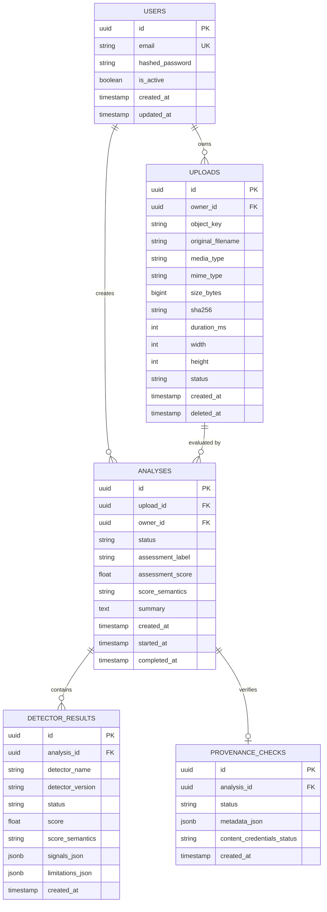

# OmniScan — Data Model & Database Architecture

OmniScan uses **PostgreSQL 16** with **SQLAlchemy 2** (declarative mapped models) and **Alembic** migrations.

---

## 1. Entity Relationship Diagram



---

## 2. Table Specifications & Indexes

### 2.1 `uploads`
- `id`: `UUID`, Primary Key, default UUIDv4.
- `owner_id`: `UUID`, Foreign Key to `users.id`, nullable for unauthenticated demo sessions.
- `object_key`: `VARCHAR(512)`, S3/MinIO storage object key. Indexed.
- `original_filename`: `VARCHAR(255)`, sanitized filename.
- `media_type`: `VARCHAR(32)`, e.g. `image`, `audio`, `video`. Indexed.
- `mime_type`: `VARCHAR(128)`, verified MIME type from magic bytes.
- `size_bytes`: `BIGINT`, file size in bytes.
- `sha256`: `CHAR(64)`, SHA-256 hex digest. Indexed for deduplication check.
- `duration_ms`: `INTEGER`, duration for audio/video in milliseconds.
- `width`: `INTEGER`, pixel width for images/video.
- `height`: `INTEGER`, pixel height for images/video.
- `status`: `VARCHAR(32)`, e.g. `uploaded`, `deleted`, `quarantined`.
- `created_at`: `TIMESTAMP WITH TIME ZONE`, default `now()`.
- `deleted_at`: `TIMESTAMP WITH TIME ZONE`, soft-delete / retention marker.

### 2.2 `analyses`
- `id`: `UUID`, Primary Key.
- `upload_id`: `UUID`, Foreign Key to `uploads.id`, Indexed.
- `owner_id`: `UUID`, Foreign Key to `users.id`, nullable.
- `status`: `VARCHAR(32)`, `queued`, `processing`, `completed`, `failed`, `detector_not_configured`. Indexed.
- `assessment_label`: `VARCHAR(64)`, e.g. `likely_synthetic`, `inconclusive`, `no_manipulation_detected`.
- `assessment_score`: `FLOAT`, normalized score between 0.0 and 1.0.
- `score_semantics`: `VARCHAR(64)`, e.g. `calibrated_probability`, `anomaly_index`.
- `summary`: `TEXT`, evidence-grounded summary text.
- `created_at`: `TIMESTAMP WITH TIME ZONE`.
- `started_at`: `TIMESTAMP WITH TIME ZONE`.
- `completed_at`: `TIMESTAMP WITH TIME ZONE`.

### 2.3 `detector_results`
- `id`: `UUID`, Primary Key.
- `analysis_id`: `UUID`, Foreign Key to `analyses.id`, ON DELETE CASCADE.
- `detector_name`: `VARCHAR(128)`.
- `detector_version`: `VARCHAR(32)`.
- `status`: `VARCHAR(32)`, `completed`, `failed`, `not_configured`.
- `score`: `FLOAT`, raw or normalized score.
- `score_semantics`: `VARCHAR(64)`.
- `signals_json`: `JSONB`, exact extracted forensic signals (e.g. FFT anomalies, pitch variances).
- `limitations_json`: `JSONB`, known limitations for the detector.
- `created_at`: `TIMESTAMP WITH TIME ZONE`.

### 2.4 `provenance_checks`
- `id`: `UUID`, Primary Key.
- `analysis_id`: `UUID`, Foreign Key to `analyses.id`, ON DELETE CASCADE.
- `status`: `VARCHAR(64)`, `verified`, `incomplete`, `not_found`, `not_supported`.
- `metadata_json`: `JSONB`, extracted EXIF, IPTC, XMP or C2PA manifest attributes.
- `content_credentials_status`: `VARCHAR(64)`.
- `created_at`: `TIMESTAMP WITH TIME ZONE`.

---

## 3. Database Migrations Workflow (Alembic)

Database schema evolution is managed via **Alembic** under `services/api/alembic`.

### 3.1 Applying Migrations
To upgrade the database schema to the latest version:
```bash
cd services/api
alembic -c alembic.ini upgrade head
```
Or from the monorepo root:
```bash
services/api/venv/Scripts/alembic.exe -c services/api/alembic.ini upgrade head
```

### 3.2 Creating a New Migration
When modifying or adding SQLAlchemy models in `app/models/`:
```bash
cd services/api
alembic -c alembic.ini revision --autogenerate -m "describe_schema_change"
```

### 3.3 Inspecting Migration Status
```bash
cd services/api
alembic -c alembic.ini current
alembic -c alembic.ini history --verbose
```

### 3.4 Rolling Back Migrations
```bash
cd services/api
alembic -c alembic.ini downgrade -1
```
