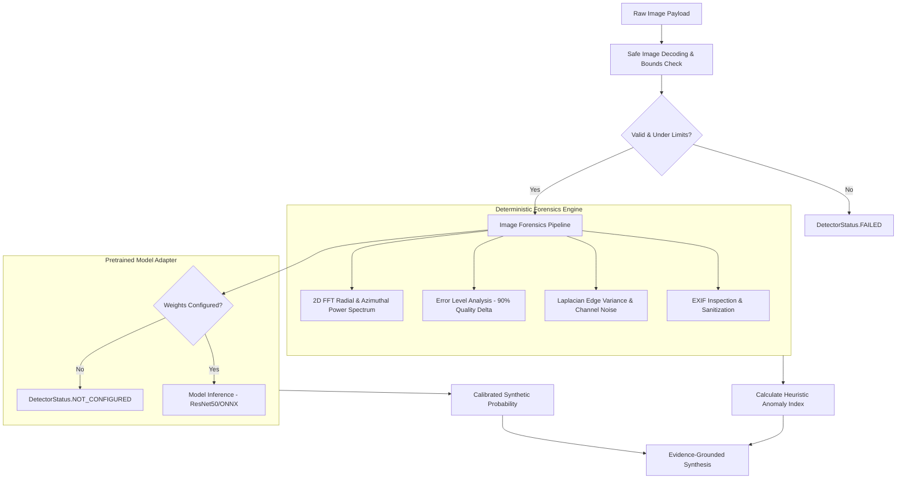

# OmniScan — Image Forensics & Deepfake Detection Specification

This document provides technical documentation, operational guidelines, licensing boundaries, and interpretation instructions for the **Milestone 4 Image Forensics Pipeline**.

---

## 1. Architectural Overview

OmniScan adopts a **dual-engine forensic strategy**:
1. **Deterministic Forensics (`image_forensics_v1`)**: Extracts multi-band mathematical and signal-level features directly from image data using OpenCV, NumPy, and Pillow. Operates locally with zero external network calls.
2. **Pretrained Deep Learning Adapter (`image_model_adapter_v1`)**: Optional, pluggable adapter for neural network architectures (e.g., ResNet-50, EfficientNet). When model weights are not configured, it honestly reports `status="not_configured"` and `score=None`.



---

## 2. Deterministic Forensic Indicators

### 2.1 2D Discrete Fourier Transform (FFT) Spectral Analysis
- **Principle**: Natural photographic images exhibit continuous radial decay in the frequency domain. Generative pipelines (e.g., GANs, Latent Diffusion upscalers) frequently leave periodic grid artifacts caused by transposed convolution or bilinear upsampling operations.
- **Computed Metrics**:
  - `high_frequency_ratio`: Ratio of high-frequency energy (outer 50-100% radius) to total spectral energy.
  - `peak_frequency_z_score`: Statistical outlier score measuring peak high-frequency spikes.
  - `grid_spikes_detected`: Boolean flag triggered when `peak_frequency_z_score > 5.5`.
- **Forensic Caveat**: Repetitive physical textures (e.g., fabric weave, brick grids, fine wire mesh) can produce natural frequency peaks. Not proof of AI generation.

### 2.2 Error Level Analysis (ELA)
- **Principle**: In lossy JPEG compression, images are stored in $8 \times 8$ or $16 \times 16$ discrete cosine transform blocks. When an image is modified or spliced, the newly saved regions degrade at a different rate than older regions.
- **Computed Metrics**:
  - `mean_error`: Average pixel difference after recompression at quality 90.
  - `block_variance`: Variance of mean error across $16 \times 16$ blocks.
  - `high_discrepancy_detected`: Flagged when `block_variance > 12.0` on a lossy JPEG file.
- **Forensic Caveat**: ELA is non-applicable to lossless formats (PNG, lossless WebP). Multiple passes of uniform compression can mask splicing.

### 2.3 Computer Vision Edge & Residual Noise Analysis
- **Laplacian Focus Variance**: Computes the variance of the 2D Laplacian operator `cv2.Laplacian(gray, cv2.CV_64F).var()`. Values $< 50.0$ indicate unnatural softness or bilateral filter smoothing.
- **Channel Noise Estimation**: High-pass filtered residual standard deviation across R, G, and B channels. Artificial image generators often produce uniform noise across color planes, whereas physical Bayer color-filter sensors exhibit channel-specific noise profiles.

### 2.4 Metadata & EXIF Analysis
- **Privacy Sanitization**: GPS coordinates, personal tags, and hardware serial numbers are stripped.
- **Heuristic Indicators**: Inspects `Tag 305 (Software)` for signatures of generative platforms (Stable Diffusion, Midjourney, DALL-E) or editing software (Photoshop, GIMP).

---

## 3. Pretrained Model Adapter (`PretrainedImageModelAdapter`)

### 3.1 Model Specification
- **Target Architecture**: ResNet-50 / EfficientNet Binary Classifier (Authentic vs. Synthetic).
- **Supported Formats**: ONNX (`.onnx`), TorchScript (`.pt`), PyTorch (`.pth`).
- **Input Dimensions**: $224 \times 224 \times 3$, normalized with ImageNet mean `[0.485, 0.456, 0.406]` and std `[0.229, 0.224, 0.225]`.
- **Output Semantics**: Softmax probability $[0.0, 1.0]$ representing synthetic likelihood.
- **Licensing**: Weights must comply with permissive licenses (Apache 2.0 / MIT / CC-BY-4.0).

### 3.2 Configuration Instructions
To enable neural model inference in local or production environments:
1. Place the model weights file on the filesystem (e.g., `services/api/weights/resnet50_deepfake.onnx`).
2. Set the environment variable in `.env`:
   ```bash
   IMAGE_MODEL_PATH=/path/to/weights/resnet50_deepfake.onnx
   IMAGE_MODEL_DEVICE=cpu # or 'cuda' if GPU is available
   ```
3. Restart the FastAPI service. `detector_registry.get_statuses()["image_model_adapter_v1"]` will update to `available`.

When `IMAGE_MODEL_PATH` is left unset, OmniScan **never generates mock scores**. It transparently marks the model status as `not_configured`.

---

## 4. Scoring Semantics & Truthfulness

| State | Score Value | Semantics | Meaning |
|---|---|---|---|
| **Deterministic Heuristics Only** | `0.00 – 1.00` | `anomaly_index` | Normalized severity index measuring presence of periodic grid peaks, ELA discrepancies, or software tags. **Not a probability**. |
| **Model Configured & Evaluated** | `0.0000 – 1.0000` | `calibrated_probability` | Probabilistic prediction from neural classifier based on representation in training set. |
| **Model Unconfigured** | `None` | `not_applicable` | Model weights not supplied; inference was not executed. |
| **Analysis Failed** | `None` | `not_applicable` | Media could not be decoded or was corrupt. |

---

## 5. Known Limitations & Forensic Disclaimers

1. **Probabilistic Nature**: Forensic outputs reflect statistical likelihood and mathematical artifacts, not judicial proof of authenticity or deception.
2. **Social Media Compression**: Platforms like WhatsApp, Twitter/X, and Instagram aggressively recompress, resize, and strip high-frequency spectra, which may suppress genuine generative markers or introduce false-positive block artifacts.
3. **Adversarial Perturbations**: Intentional noise injection or anti-forensic filtering can bypass both heuristic and deep learning detectors.
4. **Human Review Requirement**: Consequential determinations (legal, editorial, security) must always be corroborated by a qualified digital media analyst.
